# Brocken – Dreihundert Tage Nebel

Der Brocken im Harz, 1 141 m, als 3D-Echtzeitszene: der windigste und nebligste Berg Deutschlands, Raueis an Fichten, Masten und Fels, das Brockengespenst, die Granitklippen, das Hochmoor, der tote Fichtenwald und die Dampflok der Brockenbahn, die sich um den Gipfel schraubt. „Das Projekt der Luft“: Fortsetzung von Geiranger, mit den Packages aus `lib/Renderer.jar` und drei neuen, die im Projekt Renderer entstehen: `wind` (Wind über Gelände), `rime` (Raueis und Raureif), `rail` (Schienenweg und Züge).

| | | |
|---|---|---|
| 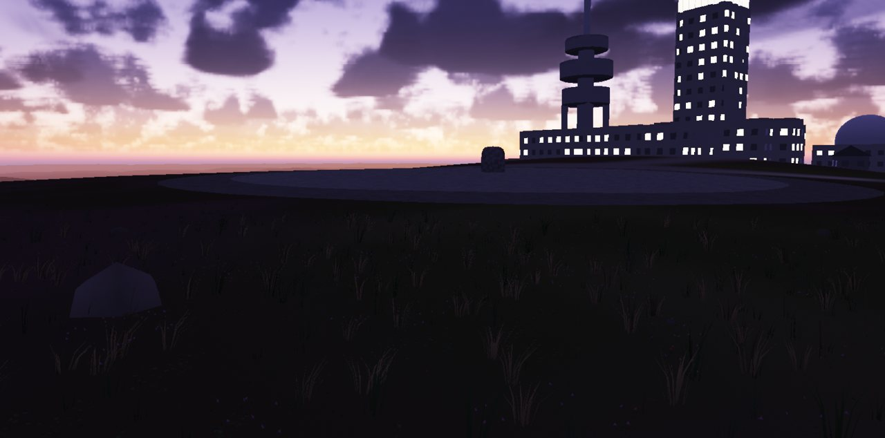 | 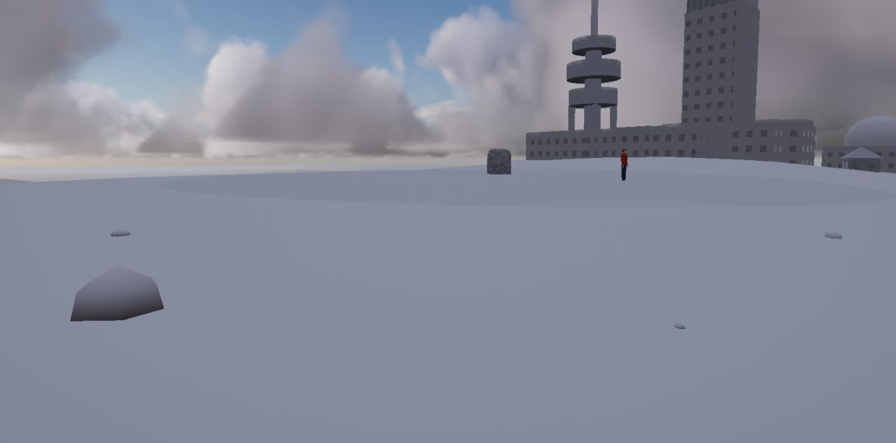 | 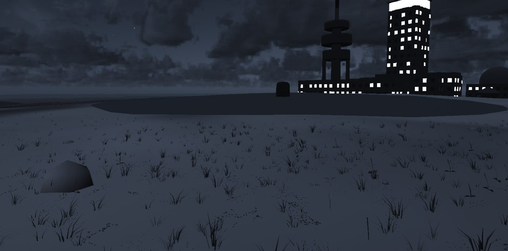 |
| Der Gipfel nach Sonnenuntergang: Brockenhotel, Sendeturm, Radom | Raueis am Gipfel im Januar | Walpurgisnacht, 30. April 23:30 |
| 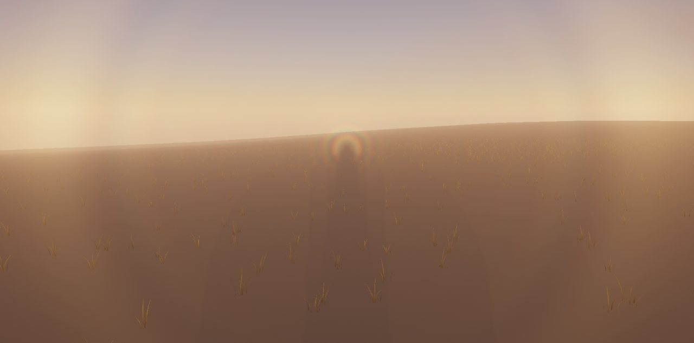 | 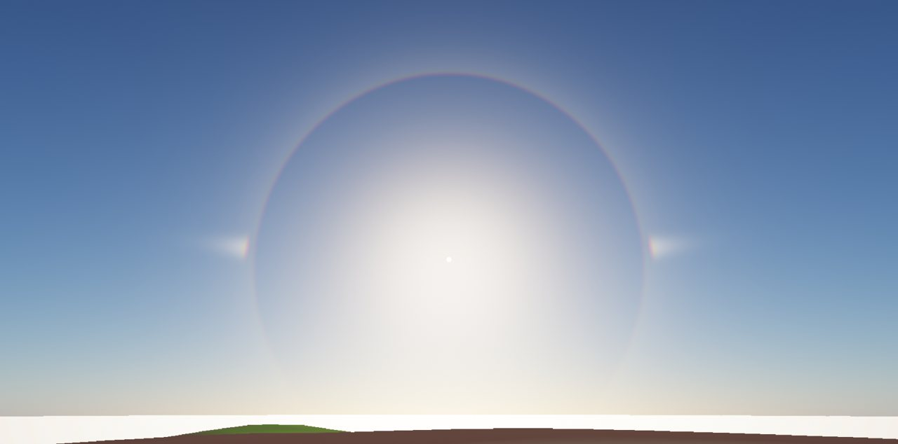 | 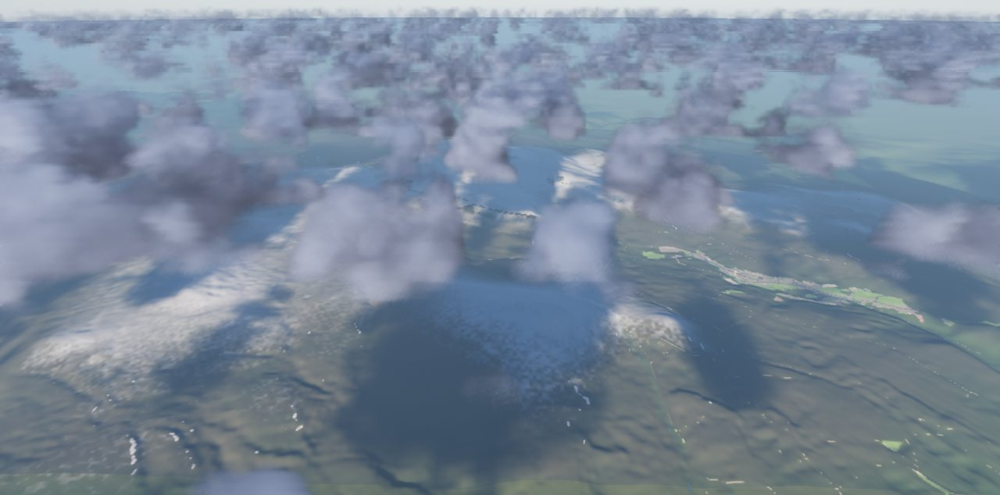 |
| Das Brockengespenst mit Glorie im Gegenpunkt der Sonne | 22°-Ring und Nebensonnen im hohen Schleier | Wolken über dem Oberharz |
| 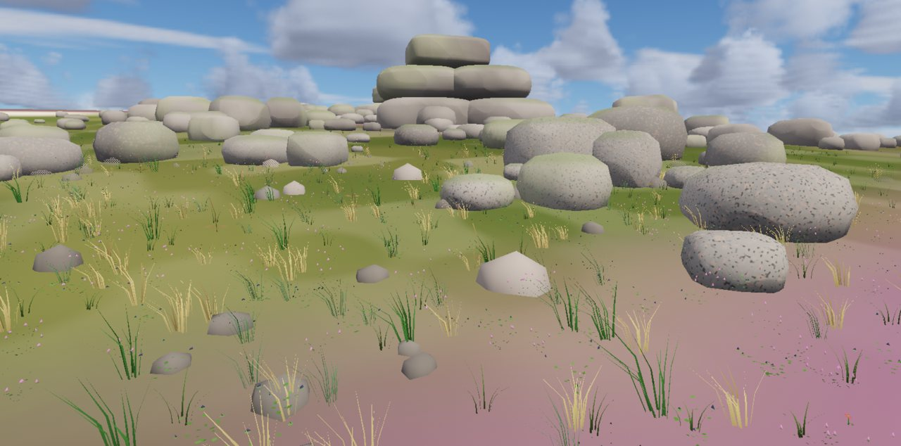 | 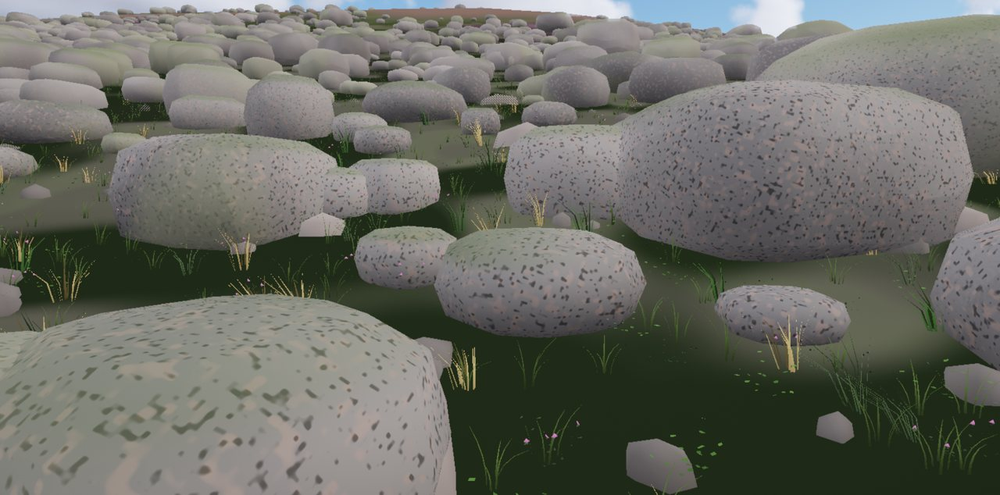 | 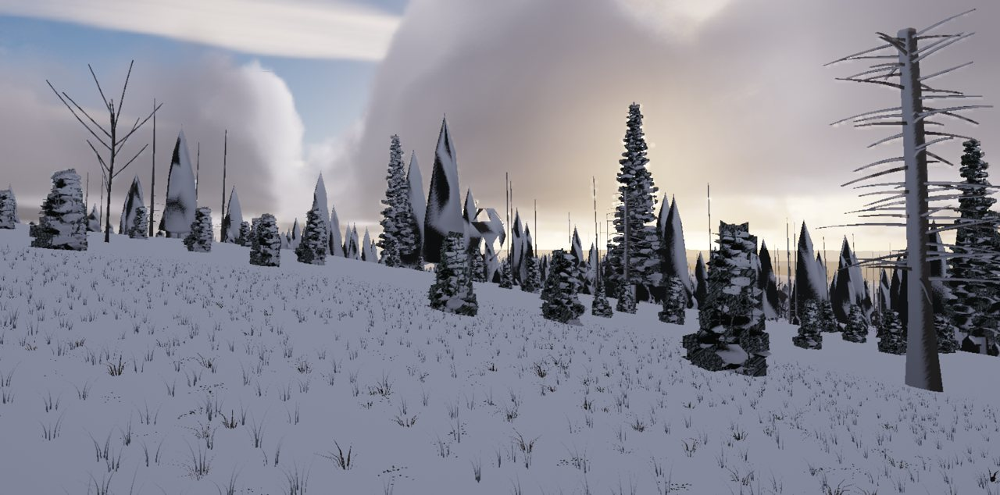 |
| Granit: Wollsäcke einer Felsburg, Heide | Blockmeer am Hang | Raueis an den Fichten der Baumgrenze |
| 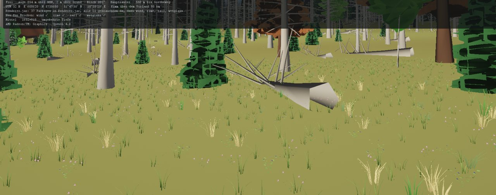 | 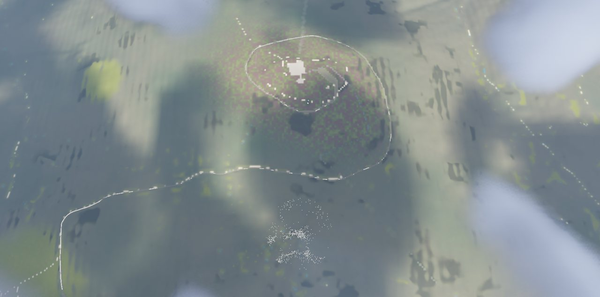 | 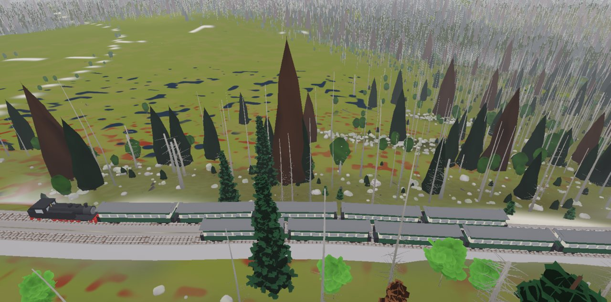 |
| Der Fichtenwald nach dem Borkenkäfer | Die Spirale der Brockenbahn um die Kuppe, von oben | Die Bergfahrt am Goetheweg |

## Starten

- `Brocken.bat` startet die App ohne NetBeans (nach Clean and Build), `Brocken_Konsole.bat` mit Konsole zur Fehlersuche. `Brocken_Verknuepfung.bat` legt die Verknüpfung „Brocken“ mit dem Symbol `Brocken.ico` auf den Desktop und ins Startmenü.
- Das Startbild: „Neu“ (21.10.2026, 9 Uhr, über dem Nebelmeer), „Weiter wie zuletzt“, „Im Kino“ mit einem der vier Regiebücher, „Einrichten“ der Datenbank, „Ohne Datenbank“.
- Qualität im Block TECHNIK: Niedrig, Mittel (Standard: 60 Bilder/s auf der Radeon 680M), Hoch und Ultra für Standbilder und Kino. `ant stufen` misst alle vier.
- Quellen und Befunde: `docs/QUELLEN.md`. Datenbank: `db/README.md`.

**Stand: Phase 18 von 18, Schliff.** Das Programmsymbol als Dateien (`ant symbol`: `Brocken.ico` und die PNGs im Jar), `Brocken.bat`, `Brocken_Konsole.bat` und `Brocken_Verknuepfung.bat`, `docs/QUELLEN.md` aus den Quellen und Befunden (`ant quellen`), dieses README mit Bildern (`docs/bilder`), `ant stufen` misst die vier Qualitätsstufen auf der Grafikkarte, `ant vorgaenger` lässt die Prüfklassen aller Packages im Projekt Renderer laufen (die Vorgänger bauen unverändert). Der Dauerlauf (`app.Dauerlauf`, Block TECHNIK „Dauerlauf 30 min“ oder `-Dbrocken.dauerlauf=30`): mindestens zwei Runden aus je zwei Regiebüchern im Kino und einem Tag frei im Zeitraffer 360, am Ende Bericht und Kurven in `docs/status/Dauerlauf_….png` und `.txt`. Hilfslinien (Marken, Pfeile, Rauchfäden) kommen nie mehr aus einer gesicherten Sitzung zurück. Seit Phase 17 Oberfläche und Datenbank. Oracle 19 auf PDBORCL, Schema `BROCKEN`, Präfix `BR_`, Spatial in SRID 8307 (Werkbuch Abschnitt 9, F25–F37 „alle A“; Einzelheiten in `db/README.md`): 39 Tabellen mit Sequenz und Trigger, 15 Geometriespalten mit räumlichem Index, sieben Sichten für QGIS (`BR_BROCKEN_V`, `BR_TAGESKARTE_V` …), Startdaten aus dem Code (`db/sql/04_startdaten.sql`, `ant startdaten`: Quellen, Befunde, Gelände mit Ausschnitten und Höhenlinien, Fels, Boden, Lagen und Übergänge, Klima, Höhenstufen, Strecke, Bahnhöfe, Fahrplan, Bauten, Orte, Wege, Wetter- und Regiebücher mit Stichworten, Ansichten, Fahrten, Presets der Packages). Das Startbild aus Rungholt: „Neu“, „Weiter wie zuletzt“ (stellt Uhr, Zeitraffer, Wetterregie mit Handreglern, Kamera, Qualität, Ton und alle Regler der letzten Sitzung her), „Einrichten“ (der Einrichter aus `com.dan.store` führt die Skripte aus und prüft danach alles; er löscht nie), „Ohne Datenbank“, „Im Kino“. Fahrplan, Klima, Lagen und Regiebücher kommen aus der Datenbank, der Code ist der Rückfall (F26). Die Chronik (`data.Chronik`, eigener Faden) schreibt jede Stunde, jeden Tag, jedes Nebelmeer, jedes Brockengespenst, jede Zugfahrt mit Verspätung und Pfiffen, Windfelder und Läufe der Regiebücher. Ohne Datenbank speichert die App in `daten/` (dieselben Spalten, gegen `01_tabellen.sql` geprüft); „Übernehmen“ trägt es beim nächsten Verbinden in die Datenbank. Block DATEN im Bedienfeld: Verbinden, Einrichten, Prüfen, Chronik mit Tageskarte, Merkpunkte (Umschalt + Klick in die Szene, mit Notiz und Vorschau), gemerkte Ansichten (Taste V), Presets je Package, eigene Regiebücher; im Block TECHNIK das Protokoll. Der Rauchfaden liegt jetzt auf Strg + Klick. Die Marken des Platzhalters (1-km-Gitter, Höhenlinien, Rahmen des Kerns) und seit 17a auch Pfeile und Rauchfäden des Windfelds sind von Anfang an aus (Blöcke TECHNIK und WIND; ein mit Strg + Klick gesetzter Faden schaltet die Fäden ein). Seit 17a sind die Flächen der Startdaten gültig für Oracle (kein Ring kreuzt einen anderen; vorher ORA-13349 in `BR_BODEN`). Seit Phase 16 Regie und Kino. Vier Regiebücher als Text (`scene.Regie`, `scene/regie/*.txt`, aus Rungholt): „Mit dem Zug auf den Brocken“ (12. Juni 2026, die Bergfahrt 10:06 ab Schierke auf der Lok, die Spirale um die Kuppe, Ankunft im Nebel), „Über dem Nebelmeer“ (21. Oktober, Sonnenaufgang, das Brockengespenst im Gegenpunkt, die Auflösung zum Mittag), „Ein Tag im Nebel“ (15. Januar 2027, die Raueislage im Zeitraffer, mit dem Wind treiben wie ein Rauchfaden, am Nachmittag klart es auf) und als Kür „Walpurgisnacht“ (30. April, ab 22 Uhr die Stimme der Sage, ein Vers aus Goethes Faust). Befehle: `zeit`, `raffer`, `wetter` (Wetter-Regiebuch des Klimas oder aus dem Kopf), `lage`, `ansicht`, `kamera`, `fahrt` (Spirale, Zum Gipfel), `mitfahren`, `blick`, `sonne`, `treiben`, `meer`, `raueis`, `walpurgis`, `warte` (uhr, abfahrt, ankunft, meer), `foto`, `blatt`, `sage`. Jedes Regiebuch macht Fotos und am Ende ein Blatt in `docs/status`. Der Kinomodus aus `com.dan.kino`: Vollbild ohne Bedienfeld und HUD, Balken 2,39 : 1, Vor- und Abspann, Untertitel aus den Stichworten, Überblendung bei jedem Schnitt, ruhiger Schwenk, Filmkorn, der Ton folgt dem Schwarz; Esc verlässt das Kino (das Regiebuch läuft weiter), die Leertaste hält an. Block REGIEBÜCHER („Im Kino“, „Abspielen“, „Anhalten“), HUD-Zeile „Regie“. Der Wind am Ohr ist 4 dB leiser (neu: `Soundscape.windGainDb`, Regler im Block KLANG). Seit Phase 15 der Klang. Der Berg klingt (`com.dan.soundscape`, verdrahtet in `wiring.KlangBrocken`; neu im Package: `Steam`, `Edge`, `Highland`, `Walpurgis`): am Ohr der Kamera der Wind aus dem Windfeld, am Gipfel laut, im Wald und im Lee leise; er singt an Mast, Antennen und Geländer und heult an Lamellen, Fugen und Hausecken. Jede Lok ist eine Quelle mit Auspuff im Takt der Treibräder (lauter und heller mit der Last, beim Anfahren mit den Zylinderhähnen), Rollen, Schienenstößen der Achsen (das „ta-tamm“ der Drehgestelle), Bremsen und Kurvenkreischen, im Stand Hilfsbläser, Luftpumpe und ab und zu das Sicherheitsventil; die Pfiffe des Zugbetriebs (Abfahrt, vor den Übergängen) klingen am Schornstein und kommen nach der Laufzeit. Fallendes Raueis klirrt an Mast und Geländer, wenn eine Fahne fällt oder Wind und Tauen dickes Eis lösen. Vögel nach Monat, Tageszeit, Ort und Wetter [G]: Ringdrossel und Wiesenpieper am Gipfel, der Hausrotschwanz an den Häusern, Buchfink, Wintergoldhähnchen und Fichtenkreuzschnabel im Wald, nachts im Spätwinter der Raufußkauz, der Kolkrabe, wo die Raben kreisen. Stimmen am Gipfelstein und am Bahnsteig nach den Menschen, Donner im Gewitter, Regen (Schnee fällt still). In der Nacht zum 1. Mai (22 bis 3 Uhr) oder von Hand die Walpurgisnacht als Stimme der Sage: der Wind ruft mit Vokalen, fern Trommeln aus dem Tal, Gelächter und Kreischen in der Luft. Alles erzeugt, keine Aufnahmen. Block KLANG (Ton, Lautstärke, Walpurgisnacht), HUD-Zeile „Klang“; `-Dton=aus` startet stumm. Nach dem Foto vom Bahnhof hat das Empfangsgebäude zwei Geschosse, das Stahlrohr des Sendeturms ist rot und weiß gebändert. Seit Phase 14 Gipfel und Menschen. Am Gipfel stehen die Bauten nach den ALKIS-Grundrissen (`scene.Gipfel`, `gl.GipfelGl`, im eigenen Programm der Szene wie F16 A sagt): Brockenhotel mit dem alten Fernsehturm und Radom, Brockenhaus mit der Kuppel der früheren Abhörstation, Wetterwarte mit Turm und Mast, Bahnhof, Wolkenhäuschen (1736), Nebengebäude; der Sendeturm von 1973 (Sockel 53 m auf vier Beinen mit drei Plattformen, Stahlrohr bis 168 m) auf der Funkfläche, der Gipfelstein in der Brockenuhr (Kreis aus Grus, 40 m), der Zaun um den Brockengarten. Höhen, Dächer und Farben sind geschätzt [G]; Fenster im Shader, nachts zum Teil erleuchtet, Hindernisfeuer, Schnee, Nässe und Raueis auf der Luvseite. Das Gelände liegt unter den Bauten eben (`Strecke.einebnen`, in derselben Änderung wie der Bahnkörper). Die Gradiente steigt zum Bahnhof Brocken auf 1 125 m (Wikipedia), das Gleis endet vor dem Empfangsgebäude, der Bahnsteig liegt auf der Seite des Gipfels, daneben ein gepflasterter Platz; Goetheweg wird nicht mehr eben gelegt. Menschen aus `com.dan.figure` (`scene.Menschen`, neu: `Outfit.mountain`): Wanderer auf der Brockenstraße (7,2 km, aus den ALKIS-Flächen „Straßenverkehr“ und „Weg“) und dem Rundweg, Fahrgäste vom Bahnsteig zum Gipfelstein nach jeder Ankunft (Halt für das Gipfelfoto, dann zum Brockenhaus) und vor jeder Talfahrt zum Zug (sie warten auf dem Bahnsteig), Besucher am Gipfelstein – nach Monat, Stunde und Wetter. Durchgänge „Gipfel“ und „Menschen“, Block GIPFEL (an/aus, „Bahnsteig“, „Gipfelstein“, „Von oben“), HUD-Zeile „Gipfel“. `Avatar.jar` für Nahes ist noch nicht eingebaut. Seit Phase 13 die Züge. Die Brockenbahn fährt nach dem Fahrplan Sommer 2026 (bahndampf.de nach der HSB; `scene.Fahrplan`, an jedem Tag [G]): acht Bergfahrten ab Schierke, sechs Talfahrten ab Brocken. Züge aus `com.dan.rail` (neu: `Train` mit Fahrdynamik – Zugkraft aus 430 kW am Rad, begrenzt durch die Reibung der Treibachsen; Steigungs-, Roll-, Luft- und Bogenwiderstand; Bogengrenze voraus; Bremskurve zu den Halten; Halte mit Abfahrtszeit, Signal, Pfiffe, Auspuffschläge, Last; `Fahrzeug`, Lage auf dem Gleis; `TrainGl`, Lok der Baureihe 99.23–24 und Wagen als Netz; `Track.parallel`, Ausweichgleise; `Bed` für mehrere Gleise). `scene.Zugbetrieb` setzt die Züge ein (Bergfahrten vom Ostrand, Talfahrten am Brocken), führt die eingleisige Strecke in drei Abschnitten mit Kreuzungen in Schierke und im neuen Bahnhof Goetheweg (955 m, mit Ausweichgleisen) und rechnet bei einem Sprung der Uhr vom Morgen nach. Schierke–Brocken dauert 34 min (Plan 33). Der Dampf kommt aus `com.dan.smoke` am Schornstein (neu: Lebensdauer je Quelle), dunkel bei voller Kraft, mit dem Wind relativ zur Lok: am stehenden Zug geht die Fahne mit dem Wind, am fahrenden liegt sie hinter der Lok. Mitfahren auf der Lok (aus dem Führerhaus gelehnt), Pfiffe als Meldung, Block BAHN mit Zügen an/aus, „Mitfahren“ und „10:00 Schierke“, HUD-Zeile „Züge“. Seit Phase 12 das Gleis. Die Brockenbahn aus `com.dan.rail` (neu: `Corridor`, Achse aus Flächen; `Track.profile`, Gradiente mit Grenze; Bahnhöfe, Überhöhung, Umläufe, Bahnübergänge; `Bed`, Bahnkörper; `RailGl` als Netz). OpenStreetMap war nicht erreichbar; die Achse ist darum die Mittellinie der ALKIS-Flächen „Bahnverkehr“ (`scene.Strecke`), vom Ostrand des Hauptrasters (Richtung Drei Annen Hohne) bis zum Bahnhof Brocken: 16,5 km, 1,43 Umläufe um den Gipfel. Die Gradiente steigt nirgends über 33 ‰; die Bahnhöfe Schierke (696 m) und Brocken (1 121 m) liegen nach den Empfangsgebäuden im ALKIS und sind eben. Damm und Einschnitt sind ins Gelände gelegt (`Terrain.korrektur`, im Shader `uTrasse`); wo das Höhenmodell neben dem Gleis um bis zu 22 m zu hoch liegt (Wald im GLO-30), gleicht es flach an. Zu sehen sind Schotter, Schienen und Schwellen, in Bögen überhöht, dazu Planum und Böschung im Gelände, zwei Bahnübergänge mit Straßen und Bahnsteige. Am Gleis stehen keine Bäume, Gras und Blöcke. Eigener Durchgang „Bahn“, Block BAHN im Bedienfeld (Gleis an/aus, Schwellen aus Beton, Sprung zu den Bahnhöfen und zum Übergang), HUD-Zeile „Bahn“. Seit Phase 11 das Jahr. Schnee am Berg aus `com.dan.season` (neu: `Heights`, das Jahr in Höhenstufen; `Drift`, Verwehungen und Wechten; `Climate.atHeight`, `Year.plantDelay`): 16 Stufen von 400 bis 1 150 m, gewürfelt nach dem Klima der Wetterwarte (DWD 1991–2020; `KlimaBrocken.jahr()`, Startwert 7, ein schneereicher Winter 2026/27) und mit dem Wetter der Regie weitergerechnet; die Abweichung des gewürfelten Tags geht an die Regie, damit Wetter und Schnee zum selben Winter gehören. Am Gipfel liegt Schnee im Mittel von Mitte Oktober bis Ende April, in Mulden und Leehängen bis Mitte Mai, an rund 164 Tagen (DWD 1961–1990: 178); in Schierke an rund 60 Tagen mindestens 5 cm (LAU: 66 in 2001–2025). Die Verwehung über dem Hauptraster (Wind aus 250°) nimmt den Schnee von der Kuppe (×0,65) und legt ihn in Mulden und Leehänge, an Kanten Wechten; im Wald verweht wenig. Im Gelände Schnee nach Stufe und Verwehung, fleckig beim Ausapern, steiler Fels bleibt dunkel; Kronenschnee im Wald, Schnee auf Felsburgen und Blöcken, Halme und Bodendecke unter Schnee, fallende Flocken (`SnowfallGl`), hellerer Boden für den Himmel. Heide und Wollgras blühen unten rund 12 Tage früher. Block JAHR im Bedienfeld (Schnee an/aus, Jahr oder von Hand, „Erster Schnee“, „Hochwinter“, „Schmelze“), HUD-Zeile „Jahr“. Seit Phase 10 Raueis. Eis am Berg aus `com.dan.rime` (neu: Fangkoeffizient α1 nach Finstad u. a. 1988 statt der Näherung, nasses Wachstum α3 nahe 0 °C, raue Oberflächen, Raten in mm/h, Lasten für Bäume; Dichte nach Macklin bis 630 kg/m³; Federn und Versatz der Ecken in `rime.glsl`): `wiring.Raueis` rechnet das Eis in Höhenbändern zu 50 m von 600 bis 1 150 m an Zweigen (4 mm), Masten (25 cm) und Fels in Szenenzeit, die Lage je Band aus der Regie (Temperatur nach der Schichtung, Flüssigwasser nach der Höhe über der Wolkenbasis, Wind nach der Höhe, Tröpfchen der Glorie); springt die Uhr, wird ein Regiebuch von seinem Beginn durchgerechnet. Die Fahnen wachsen gegen den Wind: im Wald (`ForestGl.setRime`, neu: Krone und Zweige auf der Luvseite verschoben, weiß, die Last drückt die Äste), am Fels (`CliffGl.Light.rime…`), im Gelände (`terrain.frag` mit `rime.glsl`, Bänder für Zweige und Fels), an Gras und Bodendecke. Das Regiebuch „Raueislage“ beginnt seit Phase 10 um 22 Uhr am Vorabend: Eis wächst bis 14 Uhr (am Gipfel rund 1 cm/h), um 15 Uhr klart es auf. Block RAUEIS im Bedienfeld (an/aus, Regie oder von Hand, „Raueislage“), Zeile im HUD mit Dicke, Richtung, Band, Last und Rate. Seit Phase 9 der Bergfichtenwald nach dem Borkenkäfer aus `com.dan.forest` (neu: abgestorbene, gebrochene und liegende Fichten, Windflüchter, Eberesche, Moorbirke, feste Fallrichtung im `ForestField`): rund 90 % der Fichten tot (Nationalpark Harz 2023), grau stehend, gebrochen und nach Nordost geworfen, wo der Ort zum Sturm aus Südwest offen liegt; wenige rote; dazwischen junge Fichten, oben Ebereschen, unten Birken, unter 700 m Buchen; Baumgrenze bei rund 1 100 m mit Windflüchtern. Die Waldkarte (`scene.Waldkarte`, Hauptraster zu 25 m) ist geschätzt [G] aus ALKIS, Bodenkarte und Gelände; das Gelände zeigt nah den Waldboden, fern die Kronen von oben (graubraun über dem Totholz). Durchgang „Wald“, Ansicht 9 Totholz, Block WALD UND FELS. Seit Phase 8 Fels und Boden: Granit aus `com.dan.cliff` (neu: `Cliff.granit()`, Wollsäcke aus zwei Kluftscharen und der Bankung, Felsburgen `Tor`, Blockmeer `Blockfield`, instanziert): Teufelskanzel und Hexenaltar auf der Kuppe als Burgen aus gerundeten Blöcken, Blockmeere an den Hängen über 820 m als Blöcke um das Auge, der Fels im Gelände mit dem Material aus `cliff.glsl`. Der Boden nach einer Bodenkarte (`scene.Bodenkarte`, 6 × 6 km zu 5 m, geschätzt [G] aus dem Gelände, weil ALKIS am Brocken keine Moore kennt): Moor in flachen Mulden und Sätteln zwischen 750 und 1 060 m, dazu Goethemoor und Brockenfeld als Hangmoore; Heide über der Waldgrenze; Blockfeld an Hängen von 10° bis 35°. Im Gelände: Heide als Mosaik aus Besenheide (im August violett), Heidelbeere (im Oktober rot) und Drahtschmiele, Moor aus grünem und rotem Torfmoos, Wollgras im Juni und Schlenken, Blockfeld mit Moos in den Fugen; nah am Auge die Bodendecke aus `com.dan.ground` (Biom Brocken: Zwergsträucher, Wollgras, Sonnentau, Torfmoos, Steine). Zwei neue Ansichten (7 Teufelskanzel, 8 Goethemoor), eigener Durchgang „Fels“. Seit Phase 7 streut der Nebel nach Mie mit den Tröpfchen der Lage (`com.dan.sky.Droplets`, neu: Lorenz-Mie nach Bohren und Huffman, 25 Wellenlängen, Farbe über CIE 1931): farbige Ringe der Glorie um den Gegenpunkt der Sonne (erster roter Ring 2,2° bei 10 µm, nahe 24° / r nach Laven), der fast weiße Nebelbogen rund 38° darum, vorn die Aureole. Steht das Auge (bis 2,5 m über Grund), wirft es als Wanderer seinen Schatten in den Nebel – das Brockengespenst, nur mit der Sonne im Rücken und Nebel in den ersten rund 54 m (Kernschatten). Der Gipfel wirft seinen Schatten auf das Nebelmeer (die Schattenkarte gibt seit Phase 7 auch die Höhe, ab der die Sonne scheint). Halos an Eiskristallen (22°-Ring, Nebensonnen nach Bravais) im hohen Schleier. Der Nebel rechnet in „Mittel“ in drittel, in „Hoch“ in halber Auflösung und wird kantentreu hochgerechnet (Kanten selbst gerechnet). Block NEBEL mit „Licht im Nebel“: Glorie an/aus, Tröpfchen, Halo, „In den Gegenpunkt“, „Zur Sonne“, „Meer ans Auge“. Seit Phase 6 Nebel über Gelände aus `com.dan.fog` (neu: `TerrainFog`): das Nebelmeer bei Inversion und Talnebel aus den Grenzen der unteren Schicht der Regie, das sich am Tag von unten auflöst (im Oktober bis Mittag) und nachts wieder schließt; Talnebel in den Kaltluftseen des Windfelds; bei Stau ein Gürtel am Luvhang unter der Decke (Aufwind aus dem Feld). Beim Nebelmeer zeichnet der Nebel die untere Schicht, die Wolken geben nur ihren Schatten. Block NEBEL im Bedienfeld. Seit Phase 5 Wind in der Szene: Gras (`com.dan.reed`, nach ALKIS: dicht auf der Heide der Kuppe, Reitgras im Wald, Binsen im Moor), Kolkraben (`com.dan.flock`, segeln im Aufwind am Hang aus dem Feld) und der Rauch am Brockenhotel (`com.dan.smoke`) nehmen den Wind des Felds über die neue Schnittstelle `Wind`, die auch `fog`, `forest`, `season` und `soundscape` bekommen haben (die Vorgänger bauen unverändert). Der Wind der Regie trifft die Stundenwerte der Wetterwarte (DWD 1991–2020: Monatsmittel auf 0,01 m/s, Verteilung, Richtungen), das Feld ist an der Wetterwarte in 27 m geeicht. Seit Phase 4 das Windfeld aus `com.dan.wind` ist massenkonsistent über dem Hauptraster gelöst (nach Sherman 1978 wie WindNinja; 254 × 238 × 30 Zellen zu 50 m, im eigenen Faden „Windfeld“): Rauigkeit nach ALKIS, Lee hinter Kanten, Kaltluft in Mulden, Hangwind bei Tag hinauf und bei Nacht hinab, die Schichtung aus der Regie; Masse auf besser als 0,01 % erhalten, geeicht auf den Wind der Regie am Gipfel. Pfeile in wählbarer Höhe und Rauchfäden in der Szene, eigene Fäden mit Umschalt + Klick. Seit Phase 3 Himmel aus `com.dan.sky` (Streuung über 51,8° N in der Augenhöhe, Sonne, Mond, Sterne), Wolken aus `com.dan.cloud` über dem Gelände (Nebelmeer an den Hängen, Kappe am Berg, ihr Schatten in der Höhe des Grunds), die Wetterregie `com.dan.weather` mit dem Klima „Brocken“ (Monatsmittel der DWD-Station, auf 0,5 K getroffen) und den Lagen des Mittelgebirges (Westlage mit Stau, Inversion, Raueislage), Temperatur, Wolke und Sicht in jeder Höhe, Schatten der Kuppe je Sonnenstand, Augenanpassung an Himmel und Bild, vier Wetter-Regiebücher. Seit Phase 2 das Gelände: Hauptraster aus Copernicus GLO-30 (12,5 m, um den Waldaufschlag gemindert), Fernring aus dem DGM200 (bis 100 km), im Kern das DGM1 (2 m; seit Phase 15 aus den neun Kacheln Sachsen-Anhalt E 608–613 × N 5738–5743, die den Kern ganz decken; `GeoTiff` liest das Bezugssystem jetzt nach GTModelType, weil Sachsen-Anhalt neben 25832 auch 4258 nennt); Farben nach ALKIS als Platzhalter. Seit Phase 1: die Engine aus Geiranger, Startbild, Bedienfeld, HUD; im Projekt Renderer `wind`, `rime`, `rail` als Hüllen und `wetglass`. Plan und Fortschritt stehen im Artefakt „Brocken Werkbuch“, die Statusbilder in `docs/status/`.

## Bauen und starten

- NetBeans-Projekt mit Ant, JDK 21. In `lib/`: `Renderer.jar`, JOGL mit Windows-Natives, `FStyle.jar`, `Avatar.jar`, `ojdbc11.jar`, `sdo*.jar`.
- **Clean and Build**, dann **Run** (Hauptklasse `com.dan.brocken.app.BrockenApp`). Voraussetzung: OpenGL 4.3.
- Nach einer Änderung im Projekt Renderer: dort „Clean and Build“, dann `dist/Renderer.jar` nach `lib/` kopieren; `check-packages` meldet, wenn etwas fehlt.
- **Prüfung:** `ant pruefung` endet mit „ERGEBNIS: alles in Ordnung“ (ohne Grafikkarte, löst das Windfeld auf dem echten Gelände, läuft auch `WindCheck`, `RimeCheck`, `RailCheck`, `WeatherCheck`, `CloudCheck`, seit Phase 7 `FogCheck` und `SkyCheck`, seit Phase 8 `CliffCheck` und `GroundCheck`, seit Phase 9 `ForestCheck`; seit Phase 10 prüft sie das Raueis: Fahnen gegen den Wind, mehr Eis mit der Höhe, Raten, und dass `RimeDemo` die Raten zeigt; seit Phase 11 `SeasonCheck` und das Jahr: Schnee am Gipfel von September bis Mai über 30 gewürfelte Winter, Tage mit Schnee gegen DWD und LAU, Verwehung und Wechten; seit Phase 12 die Bahn: Steigung nirgends über 3,3 %, rund 1½ Umläufe um den Gipfel, ebene Bahnhöfe, Bahnübergänge, Planum im Gelände, keine Bäume am Gleis; seit Phase 13 die Züge: der Zug ab Schierke 10:06 in der Zeit des Fahrplans am Gipfel, alle Bergfahrten pünktlich, nie zwei Züge an derselben Stelle, die Fahne mit dem Wind am stehenden Zug und hinter dem fahrenden, Sprung der Uhr, Mitfahrt; seit Phase 14 der Gipfel: Bauten aus ALKIS, Sendeturm 168 m nordwestlich vom Gipfelstein, Gelände eben unter den Bauten, Bahnhof auf 1 125 m vor dem Empfangsgebäude, Bahnsteig auf der Seite des Gipfels, Menschen nach Monat, Stunde und Wetter, und vom Bahnsteig aus sind Radom, Sendeturm, Kuppel und Bahnhof frei zu sehen; seit Phase 15 `SoundscapeCheck` und der Klang: Körper und Kanten am Gipfel, Kalender der Walpurgisnacht, am Bahnsteig der Pfiff und das Anfahren der Talfahrt 11:51, Vögel im Juni; seit Phase 16 die Regiebücher: alle vier laufen ohne Bild und ohne Eingriff bis zum Ende, alle Ansichten und Fahrten bekannt, das Kino von Vor- bis Abspann; seit Phase 17 die Daten ohne Oracle: Skripte zerlegt und gezählt, jede Geometriespalte mit Metadaten und Index, `04_startdaten.sql` passt zum Code, die Chronik eines Nebelmeer-Vormittags mit der Bergfahrt 10:06 in Dateien, „Weiter wie zuletzt“ stellt die Sitzung her, Übernahme).
- **Datenbank:** `db/README.md`. „Einrichten“ im Startbild oder im Block DATEN; `ant dbpruefung` (oder `test/…/DbPruefung.java` mit „Run File“) prüft gegen die echte Datenbank und endet mit „Alles in Ordnung.“; `ant startdaten` schreibt `db/sql/04_startdaten.sql` neu.
- **Gelände:** `ant gelaende` liest `templates/` (GLO-30, DGM200, DGM1 in `templates/dgm1/`) und `daten/alkis/` und schreibt `daten/gelaende/` und `docs/status/Gelaende_Import.png`. `ant alkis` (Python 3) schreibt `daten/alkis/` neu aus `templates/alkis_kreis_15085.gpkg`; nur nötig, wenn sich das Geopaket ändert.
- **Klima:** `ant klima` eicht das Klima „Brocken“ gegen die Station (30 gewürfelte Jahre, drei Würfel) und gibt die Zeile `EINGANG` für `wiring.KlimaBrocken` aus, dazu Niederschlag, Nebeltage und Sonnenstunden; seit Phase 5 auch die Zeile `JAHR` für den Jahresgang des Winds (`wiring.WindBrocken`) mit Mittel, Streuung, Perzentilen und Richtungen gegen die Stundenwerte. Nur nötig, wenn sich Lagen oder Zielwerte ändern.
- **Statusbilder:** seit Phase 17 schreibt `ant tempo` `docs/status/Status_Phase17.png` (Vogelauge wie bisher, ohne die Marken; `-Dmarken=an` zeigt sie), `ant regieblaetter` die Blätter der Regiebücher. Phase 16: `ant tempo` schrieb `Status_Phase16.png` und die Blätter der vier Regiebücher (`docs/status/Regiebuch_*.png`; `Tempo -Dregie=Name` lässt ein Regiebuch in Schritten zu 0,2 s durchlaufen und zeichnet nur die Fotos). Bis Phase 15: `ant tempo` schrieb `docs/status/Status_Phase15.png` (Vogelauge über dem Nebelmeer wie bisher, volles HUD, zum Vergleich der Zeit) und je ein Bild mit Hörprobe (WAV, 44,1 kHz): `Klang_Phase15_Bahnsteig.wav` (die Talfahrt 11:51 pfeift und fährt an, volles HUD), `_Mitfahrt` (auf der Lok der Bergfahrt 10:06), `_Raueis` (Gipfelstein in der Raueislage am Morgen des 15. Januar 2027), `_Sturm` (Gipfelstein im Orkan mit Regen und tauendem Eis), `_Wald` (Goetheweg an einem Maimorgen um 5:45) und `_Walpurgis` (Gipfelstein, 30. April 23:30); auf der Radeon laufen lassen und anhören – das DoD ist das Ohr. `ant raueis` schreibt `docs/status/Raueis_Phase10.png` (RimeDemo: Fahnen und Raten ohne Grafikkarte). Der Wald wird vor den Bildern gebacken und um das Auge gepflanzt, ein Regiebuch von seinem Beginn durchgerechnet. Vor den Bildern wird das Windfeld einmal gelöst. `Tempo` nimmt dazu `-Dwetter=` (Regiebuch oder Lage), `-Dregiestunde=`, `-Dpfeile=aus`, `-Dfaeden=aus`, `-Dpfeilhoehe=`, seit Phase 5 `-Dhandwind=Richtung,Stärke`, `-Dgras=aus`, `-Drauch=aus`, `-Draben=aus`, `-Dvorlauf=s`, `-Dkamera=rabe,Abstand`, seit Phase 6 `-Dnebel=aus`, seit Phase 7 `-Dmeer=Basis,Obergrenze`, `-Dmeerauge=Basis,m`, `-Dblick=gegenpunkt|sonne`, `-Dblickneigung=Grad`, `-Dhalo=0..1`, `-Dtropfen=µm`, `-Dglorie=aus`, `-Dnebelaufloesung=1|2|3`, seit Phase 8 `-Dboden=aus` und `-Dfels=aus`, seit Phase 9 `-Dwald=aus`, seit Phase 10 `-Draueis=aus|cm` (von Hand an den Zweigen am Gipfel), seit Phase 11 `-Dschnee=aus|cm` (von Hand am Gipfel), seit Phase 12 `-Dgleis=aus`, seit Phase 13 `-Dzug=aus|mit` und `-Dzugblick=Grad`, seit Phase 14 `-Dgipfel=aus`, `-Dmenschen=aus` und `-Dkamera=bahnsteig|gipfelstein|gipfel`, seit Phase 15 `-Dklang=Datei.wav`, `-Dklangsekunden=s` und `-Dwalpurgis=an`, seit Phase 16 `-Dregie=Name`, seit Phase 17 `-Dmarken=an`, `-Dpfeile=an` und `-Dfaeden=an` (alle drei sind von Anfang an aus).
- **Glorie:** `ant glorie` schreibt ohne Grafikkarte `docs/status/Glorie_Phase7.png`: Glorien für 5, 10 und 20 µm (schmal) und 10 µm (breit) mit dem Ring nach Laven, Glorie und Nebelbogen ±50° um den Gegenpunkt, die Kurven und die Halo-Winkel.
- **Granit:** `ant granit` schreibt mit der Grafikkarte `docs/status/Granit_Phase8.png` aus `com.dan.cliff.demo.CliffDemo --granit`: Granitwand, Wollsäcke aus 30 m, Felsburg, Abend, Blockmeer und nach Regen, mit dem Vergleich Grafikkarte = Prozessor.
- **Windkarte:** `ant windkarte` rechnet ohne Grafikkarte drei Lagen (Westlage, Ostwind am Tag, Nacht mit Inversion) und schreibt `docs/status/Wind_Phase4.png` (Karte in 10 m, Pfeile, Rauchfäden, Orte, Schnitt).
- **Dauerlauf:** Block TECHNIK „Dauerlauf 30 min“ oder `Brocken_Konsole.bat -Dbrocken.dauerlauf=30`; endet mit „ERGEBNIS: Dauerlauf bestanden“ in `docs/status/Dauerlauf_….txt`.
- **Tasten:** F1 zeigt alle. Maus ziehen dreht und verschiebt, Rad zoomt, W A S D gleitet, F fliegt frei, R kreist, 1 bis 9 die Ansichten, H das HUD, F11 nur die Szene, F12 ein Foto nach `docs/status/`, F5 lädt die Shader neu, Strg + Klick setzt einen Rauchfaden, Umschalt + Klick einen Merkpunkt, V merkt die Ansicht.

## Raum

UTM Zone 32 Nord (EPSG:25832), Ursprung am Gipfelstein [G] bei E 611 400, N 5 739 940: x nach Osten, z nach Süden (Nord = −z), y über NHN. Kern 3 × 3 km um den Gipfel, Hauptraster 12,7 × 11,9 km (GLO-30), Fernring bis 100 km (DGM200). Raster (`scene.Terrain`): Kern 1 536² zu 2 m, Hauptraster 1 024² zu 12,5 m, Fernring 1 024² zu 200 m; Überblendung 300 m (Kern) und 600 m (Fernring). Ohne `daten/gelaende` steht die gerechnete Kuppe von Phase 1 (`scene.Buehne`).

## Daten und Quellenvermerke

- Copernicus DEM GLO-30 (© DLR e.V. 2010–2014 und © Airbus Defence and Space GmbH 2014–2018, bereitgestellt unter COPERNICUS durch die EU und ESA)
- DGM200: © GeoBasis-DE / BKG 2026 (Daten verändert)
- Klima „Brocken“: Normalwerte 1991–2020 der Station Brocken, Deutscher Wetterdienst (Monatsmittel der Temperatur, Niederschlag); Nebeltage 1895–2019
- Lage der Teufelskanzel: Wikipedia, „Teufelskanzel (Brocken)“ (51,79769° N, 10,61625° O); Hexenaltar, Moore (Goethemoor, Brockenfeld) und Blockfelder geschätzt [G]
- Totholz: Spektrum der Wissenschaft, „Nationalpark Harz: Wo die wilde Jugend wächst“ (2023): rund 90 % des ursprünglichen Fichtenbestands abgestorben; Verjüngung aus Birke (unten), Eberesche (oben) und Fichte; Anteile je Fläche, Stürme und Baumgrenze geschätzt [G]
- ALKIS und DGM1 Sachsen-Anhalt: © GeoBasis-DE/LVermGeo ST, dl-de/by-2-0 (Daten verändert); DGM1 Niedersachsen: © LGLN (Daten verändert)
- Fahrplan der Brockenbahn: bahndampf.de, „Brockenbahn – Fahrplan, Fahrpreise, Bilder, Streckenverlauf“ (Sommer 2026, gültig ab 2. April 2026, Stand 15.09.2026; nach der HSB). Höhe des Bahnhofs Goetheweg (956 m): Wikipedia, „Brockenbahn“. Lok der Baureihe 99.23–24 (1′E1′h2t, 700 PS, 40 km/h, 64,5 t) wie im Werkbuch; Maße von Lok und Wagen, Farben der Wagen, Leistung am Rad und Widerstände geschätzt [G]
- Gipfel: Wikipedia, „Brocken“ (Bahnhof 1 125 m, Wolkenhäuschen 1736, Brockengarten 1890 und 4 600 m², Gipfelstein und Brockenuhr, Brockenhaus mit Kuppel, alter Fernsehturm 1936/37) und „Brocken Transmitter“ (alter Turm: Gebäude 53 m; Sendeturm 1973: Sockel 53 m mit vier Beinen und drei Plattformen, Rohr seit 2007 bis 168 m; der Gipfel rund 130 m südöstlich); Grundrisse aus dem ALKIS; Höhen der übrigen Bauten, Dächer, Farben und der Andrang am Gipfel geschätzt [G]
